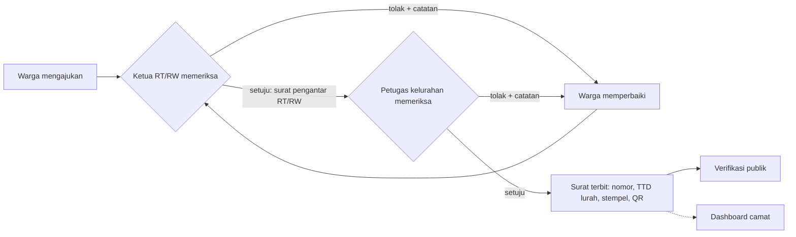

# SuratIn

**Urus surat kelurahan tanpa antre.** SuratIn adalah layanan surat administrasi kelurahan secara daring: warga
mengajukan dari ponsel, Ketua RT/RW dan petugas kelurahan memeriksa secara berjenjang, surat terbit lengkap dengan
tanda tangan, stempel digital, dan kode QR, lalu siapa pun bisa memeriksa keasliannya. Camat memantau kinerja
layanan lewat dashboard.

> Dibuat untuk **Hackathon IT Comp 2026, IT Fest Politeknik Negeri Samarinda**.

- **Demo:** `https://surat-in.vercel.app/`
- **Akun demo:** lihat bagian [Akun demo](#akun-demo). Semua kata sandi `Demo1234!`

---

## Daftar isi

1. [Latar belakang](#latar-belakang)
2. [Solusi](#solusi)
3. [Fitur utama](#fitur-utama)
4. [Alur layanan](#alur-layanan)
5. [Jenis surat](#jenis-surat)
6. [Teknologi](#teknologi)
7. [Menjalankan secara lokal](#menjalankan-secara-lokal)
8. [Deploy](#deploy)
9. [Akun demo](#akun-demo)
10. [Keamanan](#keamanan)
11. [Batasan prototipe](#batasan-prototipe)
12. [Tim](#tim)

## Latar belakang

Mengurus surat keterangan di kelurahan umumnya masih harus datang langsung: meminta surat pengantar ke Ketua RT/RW,
membawanya ke kantor kelurahan, antre, lalu kembali lagi bila ada berkas yang kurang. Warga tidak tahu sampai mana
permohonannya diproses. Di sisi lain, instansi penerima surat (bank, sekolah, rumah sakit, kepolisian) sulit
memastikan surat yang dibawa benar-benar asli, dan pimpinan wilayah tidak punya gambaran berapa lama layanan
diselesaikan.

## Solusi

SuratIn memindahkan seluruh alur itu ke satu aplikasi web:

- **Warga** mengisi formulir dan mengunggah foto KTP/KK dari ponsel, lalu memantau statusnya.
- **Ketua RT/RW** memeriksa lebih dulu dan menerbitkan surat pengantar digital.
- **Petugas kelurahan** memeriksa berkas beserta surat pengantar RT/RW, lalu menerbitkan surat final.
- **Siapa saja** bisa memeriksa keaslian surat dengan memindai QR atau mengetik nomor surat.
- **Camat** melihat dashboard kinerja layanan tanpa mengakses data pribadi warga.

## Fitur utama

**Warga**

- Pendaftaran bertingkat: pilih kelurahan, lalu RT/RW, lalu isi data diri dengan NIK.
- Formulir 3 langkah (data, berkas, tinjau) yang terisi otomatis dari profil, dengan draf tersimpan otomatis.
- Unggah foto KTP/KK: diperkecil di browser, dicek ketajamannya secara instan, dan diperiksa otomatis apakah benar
  KTP/KK. Foto yang bukan dokumen yang diminta ditolak.
- Timeline status, penanda **Baru** saat petugas memproses permohonan, dan alasan bila ditolak.
- Perbaiki lalu ajukan ulang, atau batalkan permohonan.
- Unduh surat pengantar RT/RW dan surat final (PDF).
- Ganti kata sandi di Profil dan atur ulang kata sandi dengan email + NIK.

**Ketua RT/RW**

- Antrean khusus unit RT sendiri dengan penanda batas layanan 48 jam.
- Periksa data dan berkas, lalu setujui (surat pengantar RT/RW dibuat otomatis) atau tolak dengan catatan.

**Petugas kelurahan**

- Antrean permohonan yang sudah disetujui RT/RW, dengan batas layanan 72 jam.
- Periksa berkas berdampingan dengan surat pengantar RT/RW, pratinjau surat, lalu terbitkan atau tolak.
- Surat terbit dengan nomor resmi, tanda tangan lurah, stempel kelurahan, kode QR, dan sidik SHA-256.
- Pencarian, riwayat, dan ekspor rekap CSV.

**Camat**

- Dashboard monitoring: ringkasan, perbandingan antarkelurahan, beban kerja RT/RW dan petugas, permohonan yang
  melewati batas layanan, serta statistik per jenis surat. Hanya data agregat, tanpa nama dan NIK warga.

**Publik**

- Halaman verifikasi: hasil **ASLI**, **TIDAK VALID**, atau tidak ditemukan, lengkap dengan rantai persetujuan
  RT/RW dan kelurahan.
- Pemeriksaan berkas PDF langsung di browser: sidik SHA-256 dihitung tanpa mengunggah berkas.

## Alur layanan



## Jenis surat

| Jenis surat | Hasil |
|---|---|
| Surat Keterangan Tidak Mampu (SKTM) | Surat keterangan kelurahan |
| Surat Keterangan Domisili | Surat keterangan kelurahan |
| Surat Keterangan Penghasilan Orang Tua | Surat keterangan kelurahan |
| Surat Pengantar SKCK | Surat pengantar ke kepolisian |
| Surat Pengantar Izin Keramaian (paling lambat H-3 acara) | Surat pengantar ke kepolisian |

Formulir tiap jenis surat dibangkitkan dari skema di database, dan aturan khususnya (misalnya H-3 dan jam acara)
diperiksa di browser, di server, dan di database.

## Teknologi

| Bagian | Teknologi |
|---|---|
| Aplikasi web | Next.js 16 (App Router), React, TypeScript |
| Tampilan | Tailwind CSS 4 |
| Database, autentikasi, penyimpanan berkas | Supabase (PostgreSQL, Auth, Storage, Row Level Security) |
| Validasi | Zod, React Hook Form |
| Pembuatan PDF dan QR | pdf-lib, fontkit, qrcode |
| Pemeriksaan foto dokumen | Model vision melalui API yang kompatibel dengan format chat completions (opsional) |
| Hosting | Vercel |

Struktur folder utama:

```
app/                 halaman (beranda, publik, warga, rt, admin, camat), server actions, dan API
components/          komponen antarmuka
lib/                 alur status, penerbitan surat, PDF, verifikasi, monitoring, validasi
supabase/migrations/ skema database, fungsi, dan kebijakan akses (RLS)
scripts/             pengisian data demo, reset data demo, uji keamanan
public/images/       contoh foto KTP dan KK untuk mencoba unggah berkas
```

## Menjalankan secara lokal

Prasyarat: Node.js 20.9 atau lebih baru, dan Docker Desktop (untuk Supabase lokal).

```bash
npm install
npm run db:start            # menjalankan Supabase lokal beserta migrasi
npx supabase status -o env  # salin API_URL, ANON_KEY, SERVICE_ROLE_KEY
cp .env.example .env.local  # isi nilainya dari langkah sebelumnya
npm run seed:demo           # membuat akun demo dan contoh permohonan
npm run dev                 # buka http://localhost:3000
```

Perintah lain:

| Perintah | Fungsi |
|---|---|
| `npm run reset:demo && npm run seed:demo` | Mengulang data demo dari awal |
| `npm run test:security` | Menjalankan uji keamanan dan isolasi data antarperan |
| `npm run build` | Build produksi |


## Akun demo

Semua akun memakai kata sandi **`Demo1234!`**.

| Email | Peran | Wilayah |
|---|---|---|
| `warga@demo.id` | Warga | Kel. Sidomulyo, RT 01/RW 01 |
| `warga2@demo.id` | Warga | Kel. Sidomulyo, RT 02/RW 01 |
| `warga.b@demo.id` | Warga | Kel. Karang Anyar, RT 03/RW 02 |
| `rt01.sidomulyo@demo.id` | Ketua RT/RW | RT 01/RW 01 Sidomulyo |
| `rt02.sidomulyo@demo.id` | Ketua RT/RW | RT 02/RW 01 Sidomulyo |
| `rt03.karanganyar@demo.id` | Ketua RT/RW | RT 03/RW 02 Karang Anyar |
| `rt04.karanganyar@demo.id` | Ketua RT/RW | RT 04/RW 02 Karang Anyar |
| `admin.sidomulyo@demo.id` | Petugas kelurahan | Kel. Sidomulyo |
| `admin.karanganyar@demo.id` | Petugas kelurahan | Kel. Karang Anyar |
| `camat@demo.id` | Camat | Kec. Maju Jaya |

Data demo berisi 11 permohonan untuk kelima jenis surat dalam berbagai status, termasuk 4 surat terbit. Contoh
nomor surat untuk dicoba di halaman verifikasi: `460/001/KEL-SDM/X/2026`.

Contoh foto KTP dan KK untuk mencoba unggah berkas tersedia di `/images/dummy-ktp.png` dan `/images/dummy-kk.jpg`.
Kata sandi akun demo tidak dapat diganti selama mode demo aktif, agar tetap bisa dipakai bergantian. Untuk mencoba
pendaftaran, ganti kata sandi, atau lupa kata sandi, daftarkan akun baru.

**Skenario uji singkat:** masuk sebagai warga dan ajukan surat → masuk sebagai Ketua RT/RW di wilayah yang sama lalu
setujui → masuk sebagai petugas kelurahan lalu terbitkan → kembali sebagai warga dan unduh PDF → pindai QR atau
ketik nomornya di halaman Cek keaslian.

## Keamanan

- **Isolasi data dengan Row Level Security:** warga hanya melihat permohonannya sendiri, Ketua RT/RW hanya unitnya,
  petugas hanya kelurahannya dan hanya setelah disetujui RT/RW, sedangkan camat tidak memiliki akses ke tabel mentah.
- **Perubahan status satu pintu:** setiap persetujuan dan penolakan melewati fungsi database yang memeriksa peran,
  wilayah, dan status asal dalam satu transaksi, sehingga klik ganda atau dua petugas bersamaan tidak memproses
  permohonan dua kali.
- **Riwayat tidak dapat diubah:** riwayat persetujuan dan surat terbit dikunci di database. Status terbit dan
  dibatalkan bersifat final.
- **Berkas pribadi terlindungi:** foto KTP/KK dan PDF hanya dibuka lewat server setelah hak akses dicek, dengan
  tautan sementara 60 detik.
- **Keaslian surat:** setiap surat memiliki kode verifikasi acak dan sidik SHA-256. Perubahan satu karakter pada PDF
  membuat hasil verifikasi TIDAK VALID.
- **Lainnya:** pembatasan percobaan login, pendaftaran, dan verifikasi; header keamanan HTTP; kunci layanan dan
  kunci AI hanya tersimpan di server.

## Batasan prototipe

- Tanda tangan dan stempel elektronik masih simulasi visual dengan sidik SHA-256, belum tersertifikasi BSrE/BSSN.
- NIK belum dicocokkan ke data Dukcapil. Nama wilayah, pejabat, dan data warga di demo adalah fiktif.
- Atur ulang kata sandi memakai email + NIK karena belum ada pengiriman email/SMS. Versi produksi perlu kode
  sekali pakai (OTP).
- Belum ada notifikasi WhatsApp/email dan panel pengelola sistem.

## Tim

| Nama | Peran |
|---|---|
| `Muchamad Shofiyul Qalby` | `Full Stack` |
| `Danis Audric Mahadana` | `Ide Konsep` |

Nama tim: `BURJO DAMAR KENAPA KAMU TUTUP, AKU JADI GABISA LAPRAK`
